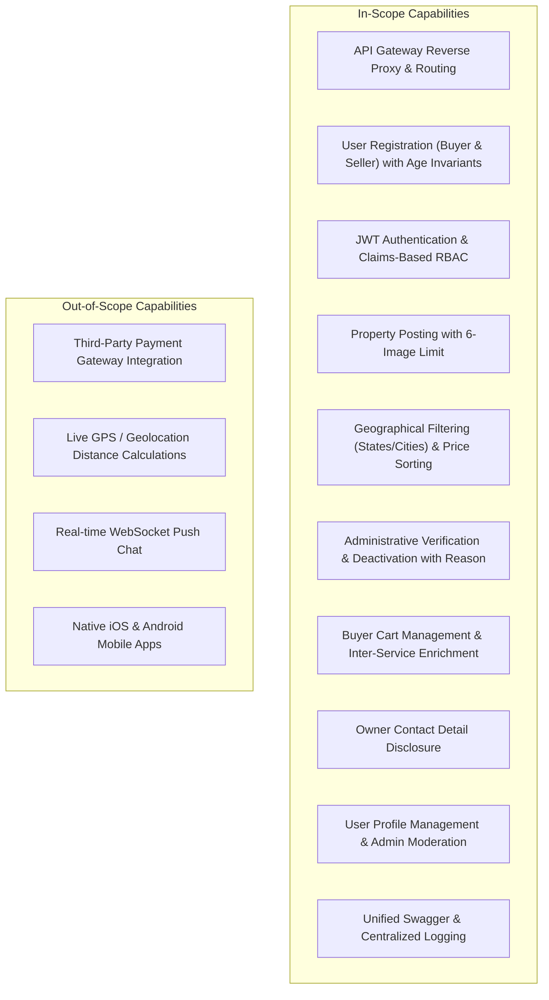
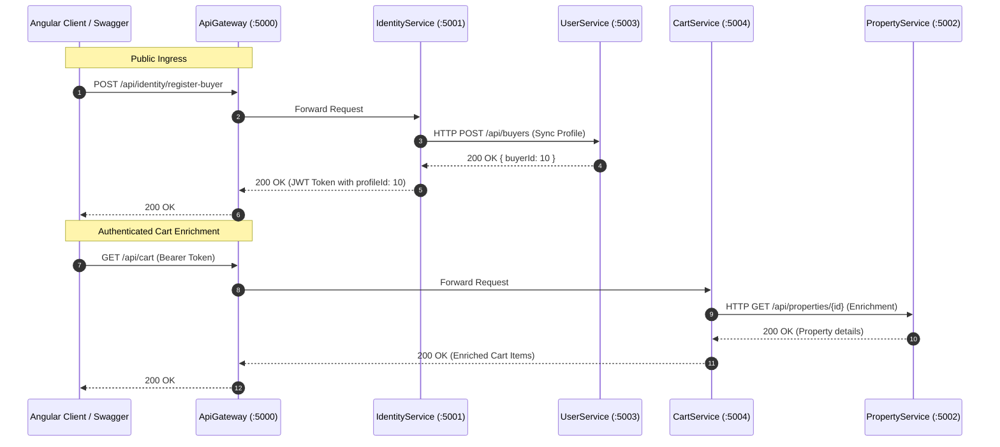
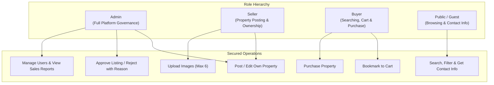
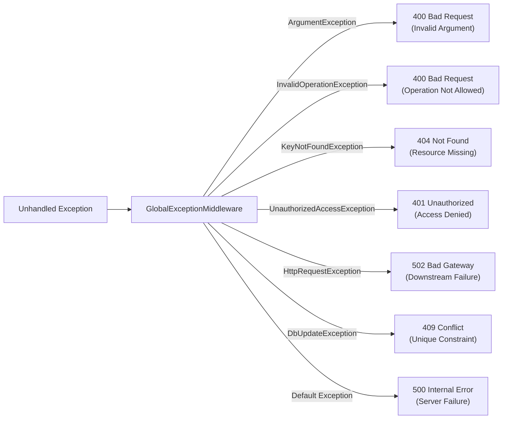
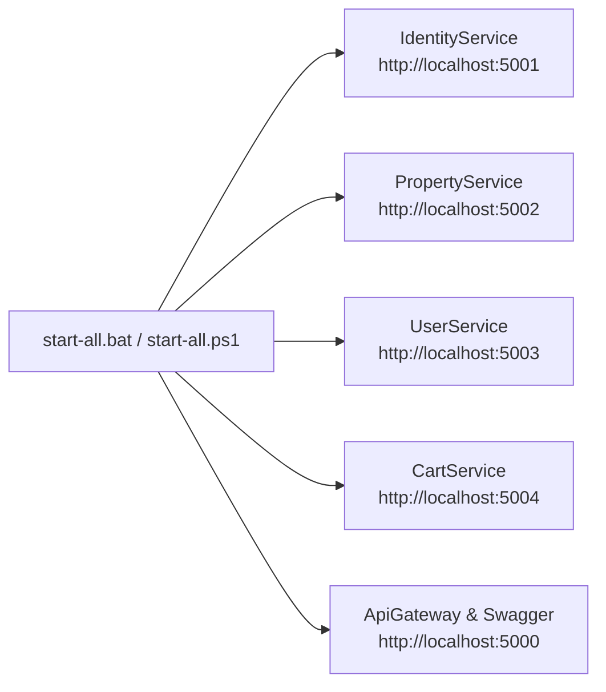

# High Level Design (HLD)
# Easy Housing Solutions (EHS) - Backend Architecture
### ASP.NET Core 8.0 Web API | Microservices | Ocelot API Gateway | SQL Server

---

## Document Control

| Item | Detail |
| :--- | :--- |
| **Document title** | High Level Design (HLD) - Easy Housing Solutions (EHS) |
| **Project** | Easy Housing Solutions (Capgemini Sprint Case Study) |
| **Document version** | 1.0 |
| **Author** | Antigravity AI / Engineering Team |
| **Date** | 17 November 2026 |
| **Status** | Approved Architectural Blueprint |
| **Related documents** | [BACKEND_LLD.md](file:///c:/Users/sgupt251/OneDrive - Capgemini/Desktop/P1/BACKEND_LLD.md); Beginner & Viva Guide; API Specifications |

### Revision History

| Version | Date | Author | Description of Change |
| :--- | :--- | :--- | :--- |
| 1.0 | 17-Nov-2026 | Engineering Team | Initial release of High Level Design (HLD) covering system topography, architectural decisions, subsystems, security, and deployment |

### Abbreviations

| Term | Meaning |
| :--- | :--- |
| **HLD** | High Level Design |
| **LLD** | Low Level Design |
| **API** | Application Programming Interface |
| **JWT** | JSON Web Token |
| **RBAC** | Role-Based Access Control |
| **ADR** | Architecture Decision Record |
| **BOM** | Bill of Materials |
| **SPA** | Single Page Application |
| **ORM** | Object-Relational Mapper (Entity Framework Core) |

---

## Table of Contents
1. [Document Purpose & Executive Summary](#10-document-purpose--executive-summary)
2. [Project Background & Business Objectives](#20-project-background--business-objectives)
3. [Scope of the System](#30-scope-of-the-system)
4. [Stakeholders & User Personas](#40-stakeholders--user-personas)
5. [Architectural Principles & Design Philosophy](#50-architectural-principles--design-philosophy)
6. [High-Level System Architecture](#60-high-level-system-architecture)
7. [Subsystems & Microservices Breakdown](#70-subsystems--microservices-breakdown)
8. [Data Architecture & Storage Strategy](#80-data-architecture--storage-strategy)
9. [Integration & Inter-Service Communication](#90-integration--inter-service-communication)
10. [Security & Identity Architecture](#100-security--identity-architecture)
11. [Cross-Cutting Concerns & Observability](#110-cross-cutting-concerns--observability)
12. [Non-Functional Requirements (NFR) Fulfillment](#120-non-functional-requirements-nfr-fulfillment)
13. [Deployment & Infrastructure Architecture](#130-deployment--infrastructure-architecture)
14. [Technology Stack & Bill of Materials](#140-technology-stack--bill-of-materials)
15. [Architecture Decision Records (ADRs)](#150-architecture-decision-records-adrs)

---

## 1.0 Document Purpose & Executive Summary

### 1.1 Document Purpose
This High-Level Design (HLD) document defines the enterprise architecture, subsystem boundaries, data partitioning strategies, security models, and infrastructural blueprints for the **Easy Housing Solutions (EHS)** platform. It serves as the primary technical specification for architects, developers, security auditors, and product evaluators.

### 1.2 Executive Summary
Easy Housing Solutions is a distributed real-estate marketplace platform built on **.NET 8.0** and **Angular 18**. The platform facilitates digital property listings, photo asset management, regional filtering, price sorting, buyer shortlisting (Cart), contact disclosure, and administrator moderation. The system is architected as an **independent microservices ecosystem** fronted by an **Ocelot API Gateway** and backed by a **Database-per-Service** data layer.

---

## 2.0 Project Background & Business Objectives

### 2.1 Project Background
Traditional real estate listing processes suffer from fragmented data, unauthorized listings, lack of administrative verification, and insecure communication between property owners and prospective tenants/buyers. Easy Housing Solutions resolves these bottlenecks by providing:
* A moderated environment where listings must be reviewed and approved by administrators before public exposure.
* Structured property information categorized by geographic states and cities.
* Transparent owner contact disclosures for verified listings.
* An interactive bookmarking cart allowing consumers to shortlist properties of interest.

### 2.2 Business Objectives
* **Trust & Quality**: Eliminate misleading listings through administrative verification and mandatory reason logging on deactivations.
* **Modularity**: Ensure that property listing spikes or user registration spikes do not degrade other modules.
* **Separation of Concerns**: Decouple authentication and user identities from property catalog management and cart persistence.
* **Ease of Integration**: Unify disparate backend services under a single API Gateway entry point with comprehensive OpenAPI / Swagger specifications.

---

## 3.0 Scope of the System



---

## 4.0 Stakeholders & User Personas

| Persona | Role | Core Capabilities in System |
| :--- | :--- | :--- |
| **Consumer / Buyer** | End-User | Searches properties by region/type, sorts by price, views details, clicks "Get Contact Details", bookmarks listings in Cart, and purchases properties. |
| **Owner / Seller** | Property Provider | Registers account, posts properties for sell/rent, uploads up to 6 images per property, updates listings, and views verified vs deactivated listings. |
| **Administrator** | Governance | Moderates listings (approves or deactivates with mandatory reason), filters by owner/region, manages users (activate/deactivate/roles), and monitors sales reports. |
| **API Consumer / Client** | Presentation | Angular 18 Single-Page Application (SPA) interacting exclusively via the Ocelot API Gateway on port 5000. |

---

## 5.0 Architectural Principles & Design Philosophy

The system architecture is guided by six foundational design principles:

1. **Microservices Decomposition**: Business capabilities are segregated into distinct services (**Identity**, **Property**, **User**, **Cart**).
2. **Database-per-Service**: To avoid tight coupling and single points of database failure, each microservice manages its own schema. No service executes cross-database SQL queries.
3. **API Gateway as Single Point of Ingress**: Clients communicate exclusively with the Ocelot API Gateway. Direct client-to-microservice coupling is prohibited.
4. **Clean Architecture Layering**: Within each service, code is strictly segregated into API, Application, Domain, and Infrastructure layers.
5. **Stateless Security**: Sessions are maintained client-side via cryptographically signed JSON Web Tokens (JWT).
6. **Graceful Degradation**: Inter-service dependencies (e.g. Cart querying Property for enriched details) are engineered with fallbacks to avoid cascading failures.

---

## 6.0 High-Level System Architecture

```mermaid
flowchart TD
    subgraph PresentationLayer ["1. Presentation Layer"]
        AngularApp["Angular 18 SPA Client\n(Port 4200)"]
        SwaggerPortal["Unified Swagger UI\n(Port 5000/swagger)"]
    end

    subgraph IngressLayer ["2. API Gateway & Ingress Layer"]
        OcelotGW["Ocelot API Gateway (Port 5000)\n• Reverse Proxy & Path Rewriting\n• JWT Token Validation\n• CORS Policies\n• Serilog Request Logging"]
    end

    subgraph MicroservicesLayer ["3. Application Microservices Layer"]
        IdentitySvc["IdentityService (Port 5001)\n• User Authentication\n• JWT Token Generation\n• PBKDF2 Password Hashing"]
        PropertySvc["PropertyService (Port 5002)\n• Catalog & Listings\n• Max 6 Image Uploads\n• Regional Filtering & Price Sort\n• Verification & Moderation"]
        UserSvc["UserService (Port 5003)\n• Buyer & Seller Profiles\n• Admin User Management\n• Owner Contact Disclosure"]
        CartSvc["CartService (Port 5004)\n• Buyer Cart Management\n• Downstream Lookup via HttpClient"]
    end

    subgraph DataLayer ["4. Persistence Data Layer (SQL Server LocalDB)"]
        DbIdentity[("EHS_IdentityDb\nUsers Table")]
        DbProperty[("EHS_PropertyDb\nProperty, Images, State, City")]
        DbUser[("EHS_UserDb\nBuyer, Seller Tables")]
        DbCart[("EHS_CartDb\nCart Table")]
    end

    PresentationLayer -->|HTTP REST Requests| IngressLayer

    OcelotGW -->|/api/identity/*| IdentitySvc
    OcelotGW -->|/api/properties/*, /api/states/*, /api/cities/*| PropertySvc
    OcelotGW -->|/api/users/*, /api/admin/users/*, /api/sellers/*| UserSvc
    OcelotGW -->|/api/cart/*| CartSvc

    IdentitySvc -.->|Sync REST: POST /api/buyers, /api/sellers| UserSvc
    CartSvc -.->|Sync REST: GET /api/properties/{id}| PropertySvc

    IdentitySvc --> DbIdentity
    PropertySvc --> DbProperty
    UserSvc --> DbUser
    CartSvc --> DbCart
```

---

## 7.0 Subsystems & Microservices Breakdown

### 7.1 ApiGateway (Port 5000)
* **Function**: Acts as the reverse proxy fronting the microservices ecosystem.
* **Technology**: ASP.NET Core 8.0, Ocelot 23.3.3.
* **Key Capabilities**:
  * Unifies upstream client URLs into downstream microservice ports.
  * Aggregates OpenAPI `/swagger/v1/swagger.json` endpoints into a single interactive Swagger console.
  * Enforces global Cross-Origin Resource Sharing (CORS) allowing web clients.
  * Integrates centralized Serilog HTTP request logging.

### 7.2 IdentityService (Port 5001)
* **Function**: Central authentication server and credential store.
* **Database**: `EHS_IdentityDb`.
* **Key Capabilities**:
  * Enforces registration rules (minimum age >= 18 years, email uniqueness).
  * Hashes and verifies passwords using PBKDF2 with SHA-256.
  * Calls `UserService` to provision domain buyer/seller profile records.
  * Issues 7-day signed HMAC-SHA256 JWT tokens containing `role` and `profileId` claims.

### 7.3 PropertyService (Port 5002)
* **Function**: Real-estate catalog management and moderation engine.
* **Database**: `EHS_PropertyDb`.
* **Key Capabilities**:
  * Posts properties for "Sell" or "Rent" (defaulting to unverified status `IsActive = false`).
  * Enforces the **Max 6 Images per Property** business invariant.
  * Provides multi-parameter search (by State, City, Property Type, Purpose) and price sorting.
  * Enables admin verification (`IsActive = true`) or deactivation with a mandatory reason string.
  * Supports property purchase workflow (marking status as `"Sold to Buyer #{id}"`).

### 7.4 UserService (Port 5003)
* **Function**: Profile registry and administrative user moderation.
* **Database**: `EHS_UserDb`.
* **Key Capabilities**:
  * Stores domain profiles for `Buyer` and `Seller` entities.
  * Exposes owner contact details (`Name`, `Phone`, `Email`, `Address`) for consumer inquiries.
  * Allows administrators to list all users, activate/deactivate accounts, change roles, or delete users.

### 7.5 CartService (Port 5004)
* **Function**: Consumer shortlist and bookmarking subsystem.
* **Database**: `EHS_CartDb`.
* **Key Capabilities**:
  * Manages buyer cart items (Add, List, Delete, Clear).
  * Prevents duplicate bookmarks via a composite unique constraint `(BuyerId, PropertyId)`.
  * Queries `PropertyService` via `HttpClient` to enrich cart items with live property data.

---

## 8.0 Data Architecture & Storage Strategy

### 8.1 Database-per-Service Strategy
To guarantee decoupling and independent maintainability, each microservice owns an isolated SQL Server database. Cross-database queries are strictly forbidden.

```
+---------------------------------------------------------------------------------------------------+
|                                  SQL Server LocalDB Instance                                      |
+---------------------------------------------------------------------------------------------------+
|  [EHS_IdentityDb]         [EHS_UserDb]             [EHS_PropertyDb]           [EHS_CartDb]        |
|  Owned by:                Owned by:                Owned by:                  Owned by:           |
|  IdentityService          UserService              PropertyService            CartService         |
|  • Users Table            • Buyer Table            • State Table              • Cart Table        |
|                           • Seller Table           • City Table                                   |
|                                                    • Property Table                               |
|                                                    • Images Table                                 |
+---------------------------------------------------------------------------------------------------+
```

### 8.2 Cross-Service Data Consistency
* **Profile Synchronization**: When a user registers through `IdentityService`, an out-of-process HTTP `POST` is made to `UserService` (`/api/buyers` or `/api/sellers`). The resulting primary key (`BuyerId` or `SellerId`) is embedded into the user's JWT token as `profileId`.
* **Runtime Data Enrichment**: When a buyer queries their cart, `CartService` fetches `(CartId, BuyerId, PropertyId)` from `EHS_CartDb`, then queries `PropertyService` via HTTP GET to dynamically attach property title, pricing, and status.
* **Fault-Tolerant Reads**: If `PropertyService` is temporarily unreachable, `CartService` catches the exception and returns the cart item with `Property = null`, ensuring high availability.

---

## 9.0 Integration & Inter-Service Communication



### 9.1 Communication Protocols
* **External Clients -> API Gateway**: HTTP/1.1 REST with JSON payloads over port 5000.
* **API Gateway -> Microservices**: HTTP/1.1 REST over private service ports (5001, 5002, 5003, 5004).
* **Inter-Service Communication**: Managed via ASP.NET Core `HttpClient` utilizing dependency-injected typed HTTP clients.

---

## 10.0 Security & Identity Architecture

### 10.1 Stateless JWT Authentication
* **Token Structure**: JSON Web Token signed with HMAC-SHA256 (`HmacSha256`).
* **Shared Symmetric Key**: Centralized secret configured across all microservices via `Jwt:Key`.
* **Claims Specification**:
  * `sub` (`NameIdentifier`): User email identifier.
  * `email`: User email address.
  * `role`: User role (`Admin`, `Seller`, `Buyer`).
  * `profileId`: Integer ID corresponding to `BuyerId` or `SellerId`.

### 10.2 Role-Based Access Control (RBAC) Matrix



### 10.3 Password Hashing
* Implements the **PBKDF2 (Password-Based Key Derivation Function 2)** standard via `System.Security.Cryptography.Rfc2898DeriveBytes`.
* Utilizes a cryptographically secure 16-byte salt, SHA-256 HMAC, and 10,000 hash iterations.
* Password checks utilize `CryptographicOperations.FixedTimeEquals` to prevent side-channel timing attacks.

---

## 11.0 Cross-Cutting Concerns & Observability

### 11.1 Centralized Exception Handling
The custom middleware [GlobalExceptionMiddleware.cs](file:///c:/Users/sgupt251/OneDrive - Capgemini/Desktop/P1/Shared/EasyHousingSolution.Shared/Middleware/GlobalExceptionMiddleware.cs) captures all unhandled exceptions across microservices:



### 11.2 Structured Logging with Serilog
* Implemented via [SerilogExtensions.cs](file:///c:/Users/sgupt251/OneDrive - Capgemini/Desktop/P1/Shared/EasyHousingSolution.Shared/Logging/SerilogExtensions.cs).
* Injects request logging (`UseSerilogRequestLogging()`) capturing HTTP verb, route, status code, and execution time in milliseconds.
* Dual-sink topography: Color-coded console output and daily rolling log files under `logs/{servicename}-.log` with a 30-day retention window.

---

## 12.0 Non-Functional Requirements (NFR) Fulfillment

| NFR Category | Architectural Solution |
| :--- | :--- |
| **Modularity & Scalability** | Microservices architecture allows independent horizontal scaling of high-traffic services (e.g. `PropertyService` can be scaled independently of `IdentityService`). |
| **Fault Isolation** | Database-per-service pattern ensures that database locks or outages in `EHS_CartDb` do not affect `EHS_PropertyDb`. |
| **Security & Privacy** | Passwords salted and hashed with PBKDF2; JWT tokens signed with HMAC-SHA256; role claims enforced at API boundaries. |
| **Performance** | Asynchronous non-blocking I/O throughout (`async`/`await`), returning threads to the ASP.NET Core thread pool during database queries. |
| **Auditability** | Mandatory deactivation reason logged when administrators reject properties; Serilog captures all administrative actions. |
| **Maintainability** | Clean Architecture (Domain, Application, Infrastructure, API) enables easy unit testing with Moq and NUnit without database dependencies. |

---

## 13.0 Deployment & Infrastructure Architecture

### 13.1 Development Process Model



* **Automation Scripts**:
  * [start-all.ps1](file:///c:/Users/sgupt251/OneDrive - Capgemini/Desktop/P1/start-all.ps1) / [start-all.bat](file:///c:/Users/sgupt251/OneDrive - Capgemini/Desktop/P1/start-all.bat): Launches all microservices and the API Gateway in separate background PowerShell processes.
  * [stop-all.ps1](file:///c:/Users/sgupt251/OneDrive - Capgemini/Desktop/P1/stop-all.ps1) / [stop-all.bat](file:///c:/Users/sgupt251/OneDrive - Capgemini/Desktop/P1/stop-all.bat): Queries active process listeners on ports 5000-5004 and cleanly terminates them.

### 13.2 Production Containerization Strategy (Target Architecture)
In production, each microservice and the API Gateway package into lightweight Linux container images (Docker / ASP.NET 8 Alpine) orchestrated via Kubernetes or Azure Container Apps:
* **Ingress**: Reverse proxy ingress with SSL/TLS termination routing traffic to `ApiGateway:5000`.
* **Service Mesh**: Internal cluster DNS resolving `identity-service:5001`, `property-service:5002`, `user-service:5003`, and `cart-service:5004`.
* **Database**: Azure SQL Database or Managed SQL Server with dedicated database instances matching the Database-per-Service topology.

---

## 14.0 Technology Stack & Bill of Materials

| Component / Layer | Technology Selected | Version | Purpose / Justification |
| :--- | :--- | :--- | :--- |
| **Runtime Framework** | .NET (ASP.NET Core) | 8.0 | High-performance, cross-platform enterprise web API framework. |
| **API Gateway** | Ocelot | 23.3.3 | Lightweight, native .NET API Gateway supporting routing and path rewriting. |
| **Data Access / ORM** | Entity Framework Core | 8.0.10 | Object-Relational Mapping, LINQ queries, and code-first database migrations. |
| **Database Engine** | Microsoft SQL Server LocalDB | 2019 / 2022 | Relational database supporting ACID transactions and relational integrity. |
| **Security & Tokens** | Microsoft.AspNetCore.Authentication.JwtBearer | 8.0.10 | Industry-standard JWT authentication and validation middleware. |
| **Token Handling** | System.IdentityModel.Tokens.Jwt | 8.2.1 | Cryptographic JWT token creation and claim serialization. |
| **API Documentation** | Swashbuckle.AspNetCore | 6.6.2 | Automated OpenAPI / Swagger documentation generation. |
| **Logging** | Serilog.AspNetCore | 8.0.3 | Structured JSON logging with daily rolling file sinks. |
| **Unit Testing** | NUnit | 4.1.0 | Testing framework for unit and integration testing. |
| **Mocking Library** | Moq | 4.20.70 | Mocking framework for isolating repositories and HTTP clients in tests. |

---

## 15.0 Architecture Decision Records (ADRs)

### ADR-01: Adoption of Microservices Architecture
* **Context**: The real-estate platform has distinct functional boundaries (Identity, Properties, User Profiles, Cart).
* **Decision**: Decompose the application into 4 microservices fronted by an API Gateway.
* **Consequences**: Enhanced modularity and independent deployability; requires inter-service HTTP communication and distributed data handling.

### ADR-02: Database-per-Service Pattern
* **Context**: Using a single shared database between microservices creates tight coupling and eliminates deployment independence.
* **Decision**: Provide each service with its own dedicated database (`EHS_IdentityDb`, `EHS_PropertyDb`, `EHS_UserDb`, `EHS_CartDb`).
* **Consequences**: Guaranteed schema isolation; cross-service relations must be resolved via REST APIs rather than SQL joins.

### ADR-03: Choice of Ocelot as API Gateway
* **Context**: Clients require a unified host and port without managing direct connections to ports 5001-5004.
* **Decision**: Deploy Ocelot API Gateway on port 5000 as the single ingress router.
* **Consequences**: Simplified client configuration, centralized Swagger UI aggregation, and uniform CORS enforcement.

### ADR-04: Stateless JWT Authentication over Cookie Sessions
* **Context**: In a microservice ecosystem, server-side sessions require distributed cache stores (e.g. Redis).
* **Decision**: Issue self-contained signed JWT tokens containing role and profile claims.
* **Consequences**: Downstream microservices validate tokens independently using a shared secret without querying the Identity database on every request.

### ADR-05: Clean Architecture Layering inside Services
* **Context**: Business logic must remain decoupled from database technology and UI frameworks to ensure long-term testability.
* **Decision**: Enforce four concentric layers (`.API`, `.Application`, `.Domain`, `.Infrastructure`) within each microservice.
* **Consequences**: High testability using Moq unit tests; strict enforcement of the Dependency Inversion Principle.
