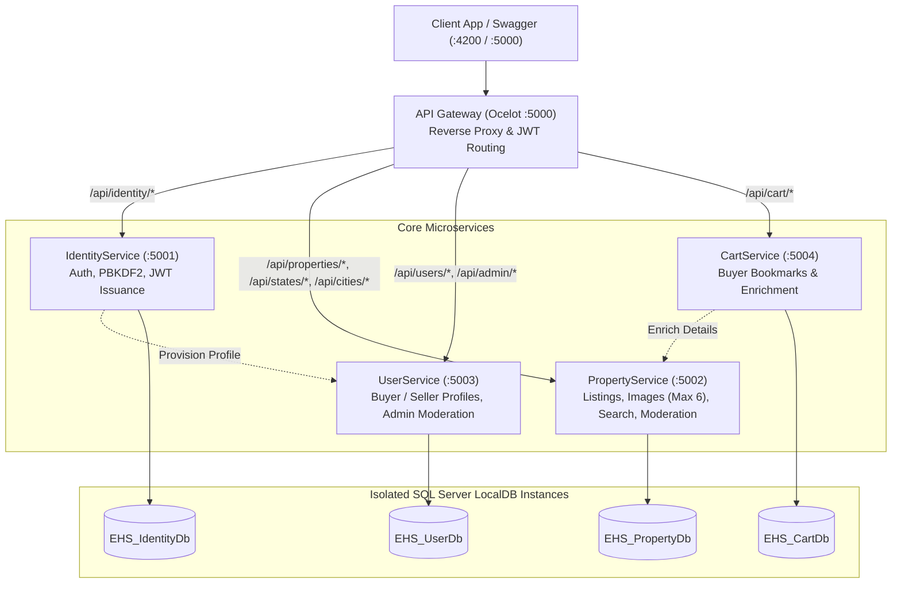
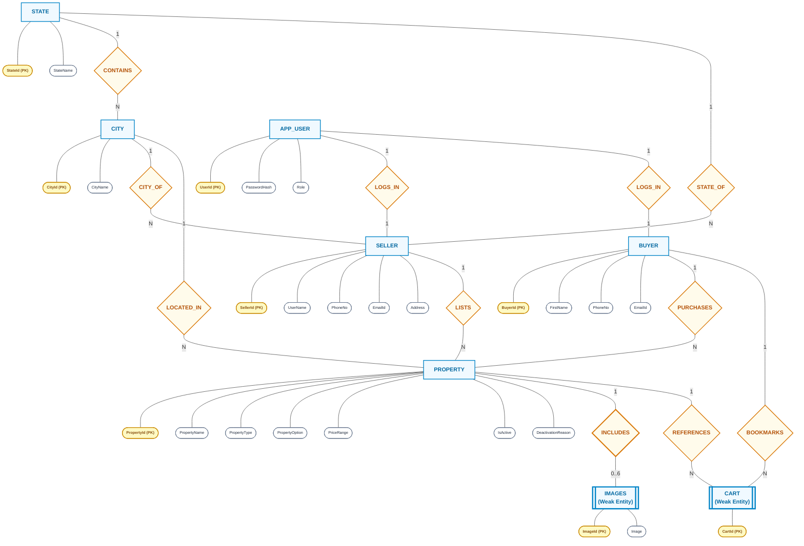
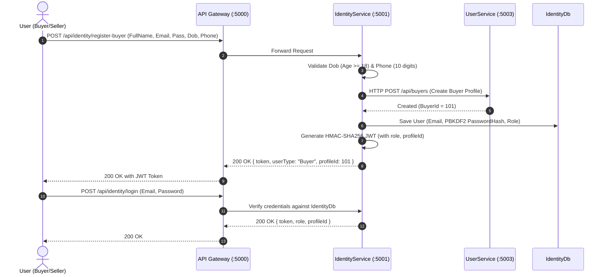
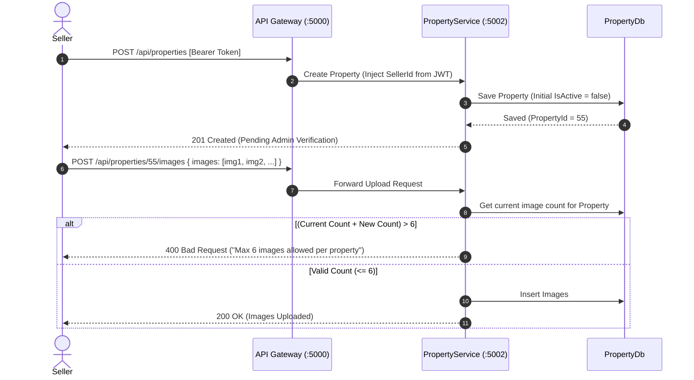
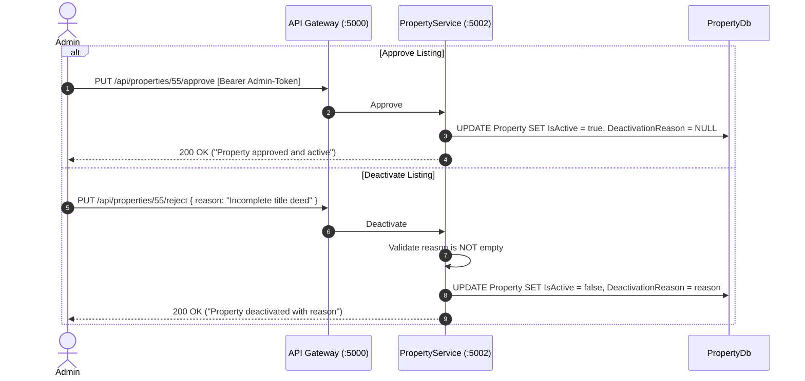
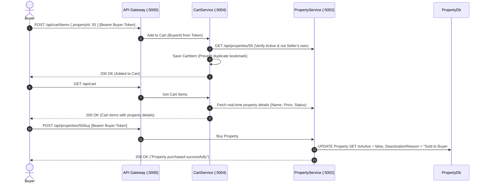

# Low Level Design (LLD)
## Easy Housing Solutions (EHS) - Backend Microservices
**.NET 8.0 Web API | Ocelot API Gateway | Entity Framework Core | SQL Server**

---

## 1. System Architecture

The backend consists of **4 decoupled microservices** fronted by a centralized **Ocelot API Gateway** on port 5000. Each microservice follows Clean Architecture and owns an independent database (**Database-per-Service**).

---

## 2. Entity-Relationship (ER) Diagram — Peter Chen Notation

---

## 3. Database Schema (Tables & Keys)

| Database | Table | Columns & Data Types | Primary / Foreign Keys | Description |
| :--- | :--- | :--- | :--- | :--- |
| **`EHS_IdentityDb`** | `Users` | `UserName` VARCHAR(25) `Password` VARCHAR(25) `UserType` VARCHAR(15) | **PK**: `UserName` | Stores credentials & role (`Admin`, `Buyer`, `Seller`). Passwords hashed via PBKDF2. |
| **`EHS_UserDb`** | `Buyer` | `BuyerId` INT (IDENTITY) `FirstName` VARCHAR(25) `LastName` VARCHAR(25) `DateOfBirth` DATE `PhoneNo` VARCHAR(10) `EmailId` VARCHAR(50) `UserName` VARCHAR(25) | **PK**: `BuyerId` **UK**: `EmailId` | Stores Buyer profiles. Validates Age >= 18 and 10-digit mobile format. |
| | `Seller` | `SellerId` INT (IDENTITY) `UserName` VARCHAR(25) `FirstName` VARCHAR(25) `LastName` VARCHAR(25) `DateofBirth` DATE `PhoneNo` VARCHAR(10) `Address` VARCHAR(250) `StateId` INT, `CityId` INT `EmailId` VARCHAR(50) | **PK**: `SellerId` **UK**: `EmailId` | Stores Seller profiles and contact information. |
| **`EHS_PropertyDb`** | `State` | `StateId` INT (IDENTITY) `StateName` VARCHAR(30) | **PK**: `StateId` | Master state lookup table. |
| | `City` | `CityId` INT (IDENTITY) `CityName` VARCHAR(50) `StateId` INT | **PK**: `CityId` **FK**: `StateId` -> `State(StateId)` | Master city lookup linked to state. |
| | `Property` | `PropertyId` INT (IDENTITY) `PropertyName` VARCHAR(50) `PropertyType` VARCHAR(15) `PropertyOption` VARCHAR(10) `Description` VARCHAR(250) `Address` VARCHAR(250) `PriceRange` MONEY `InitialDeposit` MONEY `Landmark` VARCHAR(25) `IsActive` BIT `DeactivationReason` VARCHAR(250) `SellerId` INT `CityId` INT | **PK**: `PropertyId` **FK**: `CityId` -> `City(CityId)` **Logical FK**: `SellerId` | Property listings. Initial `IsActive = false` until admin approves. |
| | `Images` | `ImageId` INT (IDENTITY) `PropertyId` INT `Image` VARCHAR(MAX) | **PK**: `ImageId` **FK**: `PropertyId` -> `Property` | Photos for property. **Max 6 images per property enforced**. |
| **`EHS_CartDb`** | `Cart` | `CartId` INT (IDENTITY) `BuyerId` INT `PropertyId` INT | **PK**: `CartId` **UK**: `(BuyerId, PropertyId)` | Buyer bookmark shortlists. Composite unique constraint prevents duplicate adds. |

---

## 4. Class Design (Core Interfaces & Services)

```mermaid
classDiagram
    %% Identity Service
    class AuthController {
        +RegisterBuyer(RegisterBuyerDto) Task~IActionResult~
        +RegisterSeller(RegisterSellerDto) Task~IActionResult~
        +Login(LoginDto) Task~IActionResult~
    }
    class AuthService {
        +RegisterBuyerAsync()
        +RegisterSellerAsync()
        +LoginAsync()
    }
    AuthController --> AuthService

    %% Property Service
    class PropertiesController {
        +CreateProperty(CreatePropertyDto) Task~IActionResult~
        +SearchProperties(cityId, type, option, sortBy) Task~IActionResult~
        +ApproveProperty(id) Task~IActionResult~
        +RejectProperty(id, RejectPropertyDto) Task~IActionResult~
        +BuyProperty(id) Task~IActionResult~
    }
    class PropertyAppService {
        +CreatePropertyAsync()
        +SearchPropertiesAsync()
        +VerifyPropertyAsync()
        +DeactivatePropertyAsync()
        +BuyPropertyAsync()
    }
    class ImageAppService {
        +UploadImagesAsync(propertyId, images)
    }
    PropertiesController --> PropertyAppService

    %% User Service
    class UsersController {
        +GetMyProfile() Task~IActionResult~
        +UpdateMyProfile(UpdateUserProfileDto) Task~IActionResult~
        +GetAllUsers(role, isActive) Task~IActionResult~
        +ActivateUser(id) Task~IActionResult~
        +DeactivateUser(id) Task~IActionResult~
    }
    class UserAppService {
        +GetAllUsersAsync()
        +UpdateUserStatusAsync()
        +ChangeUserRoleAsync()
    }
    UsersController --> UserAppService

    %% Cart Service
    class CartController {
        +AddToCart(AddToCartDto) Task~IActionResult~
        +GetMyCart() Task~IActionResult~
        +RemovePropertyFromCart(id) Task~IActionResult~
        +ClearMyCart() Task~IActionResult~
    }
    class CartAppService {
        +AddToCartAsync(buyerId, propertyId)
        +GetBuyerCartAsync(buyerId)
        +RemovePropertyFromCartAsync(buyerId, id)
    }
    CartController --> CartAppService
```

---

## 5. Key Workflows (Sequence Diagrams)

### 5.1 User Registration & Login (JWT Flow)

---

### 5.2 Property Creation & 6-Image Validation Workflow

---

### 5.3 Admin Moderation (Approve vs Deactivate with Reason)

---

### 5.4 Buyer Cart & Purchase Workflow

---

## 6. API Canvas (All Endpoints Summary)

All endpoints route through the **Ocelot API Gateway** on port 5000 (`http://localhost:5000`).

| Service | Method | Route | Access | Description |
| :--- | :--- | :--- | :--- | :--- |
| **Identity** | `POST` | `/api/identity/register-buyer` | Public | Register new buyer (Validates Age >= 18) |
| | `POST` | `/api/identity/register-seller` | Public | Register new seller (Validates Age >= 18) |
| | `POST` | `/api/identity/login` | Public | Authenticate user & issue signed JWT token |
| **Property** | `GET` | `/api/properties/verified` | Public | Get all active approved listings |
| | `GET` | `/api/properties/{id}` | Public | Get single property with photos |
| | `GET` | `/api/properties/search` | Public | Multi-filter by State, City, Type & Sort by Price |
| | `POST` | `/api/properties` | Seller | Add property (Default `IsActive = false`) |
| | `PUT` | `/api/properties/{id}` | Seller, Admin | Edit owned listing |
| | `DELETE`| `/api/properties/{id}` | Seller, Admin | Delete property listing |
| | `GET` | `/api/properties/my-properties`| Seller | View logged-in seller listings |
| | `PUT` | `/api/properties/{id}/approve` | Admin | Approve property (`IsActive = true`) |
| | `PUT` | `/api/properties/{id}/reject` | Admin | Deactivate listing with mandatory reason |
| | `POST` | `/api/properties/{id}/buy` | Buyer | Buy property (`Sold to Buyer #{id}`) |
| | `GET` | `/api/verifications/sales-report` | Admin | Sales & property inventory valuation report |
| | `POST` | `/api/properties/{id}/images` | Seller | Upload photos (**Max 6 limit enforced**) |
| | `DELETE`| `/api/properties/{id}/images/{imgId}` | Seller | Delete a specific property photo |
| | `GET` | `/api/states`, `/api/cities` | Public | Geographic hierarchy master lookup |
| **User** | `GET` | `/api/users/profile` | Authenticated | View current logged-in profile |
| | `PUT` | `/api/users/profile` | Authenticated | Update self contact details |
| | `GET` | `/api/sellers/{id}/contact` | Public | Expose owner contact details (Phone, Email, Address) |
| | `GET` | `/api/admin/users` | Admin | View all users with role/status filters |
| | `PUT` | `/api/admin/users/{id}/activate` | Admin | Activate suspended user account |
| | `PUT` | `/api/admin/users/{id}/deactivate` | Admin | Deactivate user account |
| | `PUT` | `/api/admin/users/{id}/role` | Admin | Update role (`Admin`, `Buyer`, `Seller`) |
| **Cart** | `POST` | `/api/cart/items` | Buyer | Bookmark property to cart |
| | `GET` | `/api/cart` | Buyer | Get buyer's cart with enriched property details |
| | `DELETE`| `/api/cart/items/{id}` | Buyer | Remove single item from cart |
| | `DELETE`| `/api/cart` | Buyer | Clear buyer's entire cart |

---

## 7. Business Rules & Invariant Matrix

| Business Rule | Condition / Validation Rule | Error Response |
| :--- | :--- | :--- |
| **Age >= 18** | Registration parses DOB. Age must be at least 18 years. Future dates prohibited. | `400 Bad Request` ("Buyer must be at least 18 years old") |
| **Phone Format** | Exactly 10 digits starting with 6, 7, 8, or 9 (`^[6-9][0-9]{9}$`). | `400 Bad Request` ("Mobile number must be exactly 10 digits") |
| **Max 6 Images** | `CurrentPropertyImages + NewIncomingImages <= 6`. | `400 Bad Request` ("Cannot upload X images. Max 6 allowed") |
| **Admin Reason** | Admin deactivating property must provide non-empty reason string. | `400 Bad Request` ("Proper reason must be provided") |
| **Cart Duplication**| Cannot add the same property to the cart more than once. | `400 Bad Request` ("Property is already in buyer's cart") |
| **Self-Purchase** | A seller cannot buy or add their own property to cart (`SellerId == BuyerId`). | `400 Bad Request` ("Sellers cannot buy or rent their own properties") |
| **Token RBAC** | Protected endpoints check `[Authorize(Roles = "...")]` against JWT claims. | `401 Unauthorized` / `403 Forbidden` |

---

## 8. Unit Testing Summary

Tested in `EasyHousingSolution.Tests` using **NUnit 4.1.0** and **Moq 4.20.70**:

| Test ID | Scenario | Verification | Result |
| :--- | :--- | :--- | :--- |
| `TC-AUTH-01` | Valid Buyer Registration | Validates Dob >= 18, provisions profile in UserService, issues JWT token | **Passed** |
| `TC-AUTH-02` | Underage Registration | Rejects registration when Dob < 18 years with `400 Bad Request` | **Passed** |
| `TC-AUTH-03` | Valid Login | Verifies PBKDF2 hash, issues HMAC-SHA256 JWT with role & profile claims | **Passed** |
| `TC-PROP-01` | Property Initial State | Newly posted property is saved with `IsActive = false` | **Passed** |
| `TC-PROP-02` | **Max 6 Images Limit** | Rejects upload of 3 images if listing already has 4 images (`4 + 3 > 6`) | **Passed** |
| `TC-PROP-03` | Admin Approval | Admin verifies property; `IsActive` sets to `true`, reason cleared | **Passed** |
| `TC-PROP-04` | Admin Deactivation Reason | Rejects empty reason string `""` with `400 Bad Request` | **Passed** |
| `TC-PROP-05` | Price Sorting | `GET /api/properties/search?sortBy=price` sorts ascending by `PriceRange` | **Passed** |
| `TC-CART-01` | Cart Addition & Duplication | Prevents duplicate bookmarks with composite key `(BuyerId, PropertyId)` | **Passed** |
| `TC-CART-02` | Cart Enrichment | Enriches cart items with real-time property title, price, and status | **Passed** |
| `TC-USER-01` | Owner Contact Disclosure | Returns owner Phone, Email, and Address for verified listings | **Passed** |
