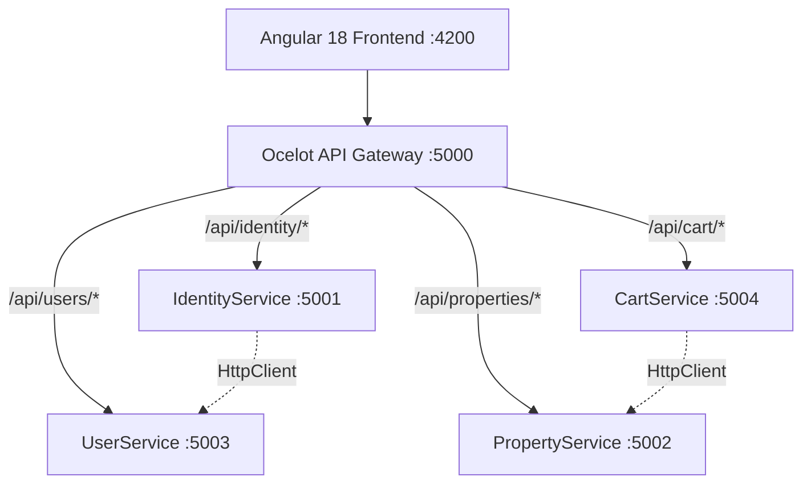
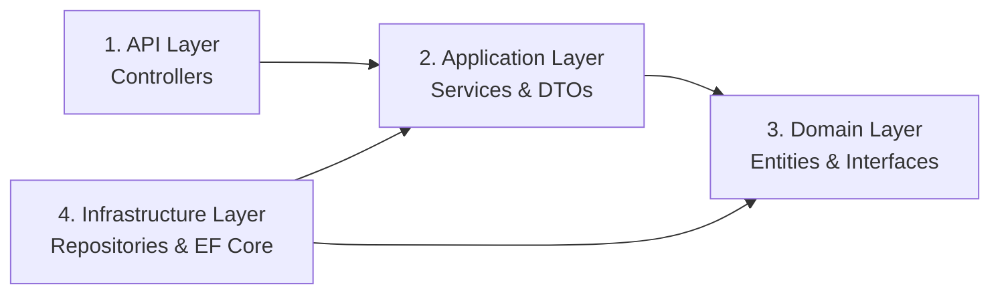

# Easy Housing Solutions (EHS) - Beginner & Viva Guide

> **Project**: Easy Housing Solutions (EHS)  
> **Course**: Capgemini .NET Core & Angular Sprint  
> **Tech Stack**: ASP.NET Core (.NET 8), Entity Framework Core, SQL Server LocalDB, Angular 18, Ocelot Gateway

---

## 1. Project Overview

**Easy Housing Solutions (EHS)** is a web-based real-estate marketplace connecting property owners, buyers, and administrators:
* **Administrator**: Reviews property listings, verifies valid properties, deactivates listings with a mandatory reason, and views properties by region or owner.
* **Owner / Seller**: Registers an account, posts properties for sell or rent, uploads up to 6 images per property, edits listings, and views verified vs deactivated listings.
* **Consumer / Buyer**: Searches properties by region or type, sorts listings by price, views property details, clicks **"Get Contact Details"** to view owner email/phone, and manages a bookmark Cart (Add, View, Remove).

---

## 2. Architecture & Design Patterns

### A. Microservices Ecosystem
The backend is split into **4 focused microservices** plus a unified **API Gateway**:

| Service | Port | Database | Primary Responsibility |
| :--- | :--- | :--- | :--- |
| **ApiGateway** | `5000` | N/A | Single entry point using Ocelot; aggregates routes and Swagger |
| **IdentityService** | `5001` | `EHS_IdentityDb` | User credentials (`Users` table), registration, and JWT token issuance |
| **PropertyService** | `5002` | `EHS_PropertyDb` | Properties, Images (max 6), States, Cities, verification/deactivation |
| **UserService** | `5003` | `EHS_UserDb` | Buyer and Seller profiles (`Buyer`, `Seller` tables) and Admin user listings |
| **CartService** | `5004` | `EHS_CartDb` | Buyer bookmark Cart (`Cart` table) |
| **AngularUI** | `4200` | N/A | Frontend presentation layer built with Angular 18 |

#### Key API Endpoints Cheatsheet
* **Property Endpoints**:
  * `GET /api/properties` — Get all verified active properties.
  * `GET /api/properties/{id}` — Get single property details.
  * `GET /api/properties/search?stateId=...&cityId=...&propertyType=...&sortBy=price` — Search & sort.
  * `GET /api/properties/seller/{sellerId}` — **View by Owner** (Admin / Seller).
  * `GET /api/properties/my-properties` — Logged-in Seller's properties.
  * `POST /api/properties` — Add new property (Seller).
  * `PUT /api/properties/{id}` — Edit property (Seller).
  * `DELETE /api/properties/{id}` — Delete property.
  * `PUT /api/properties/{id}/approve` & `PUT /api/properties/{id}/reject` — Admin moderation.
  * `GET & POST /api/properties/{propertyId}/images` — Upload property images (max 6).
* **Cart Endpoints**:
  * `GET /api/cart` — View buyer's bookmarked properties.
  * `POST /api/cart` or `POST /api/cart/items` — Add property to cart.
  * `DELETE /api/cart/items/{propertyId}` — Remove property from cart.
  * `DELETE /api/cart` — Clear cart.
* **Identity Endpoints**:
  * `POST /api/identity/login` — Login (Admin, Seller, Buyer).
  * `POST /api/identity/register-buyer` & `POST /api/identity/register-seller` — User registration.



---

### B. Clean Architecture & The Repository Pattern

Inside each microservice, code is organized into 4 strict layers:



1. **API Layer (`.API`)**:
   * Contains ASP.NET Core REST API Controllers (`PropertiesController`, `AuthController`, etc.).
   * Controllers only call the **Service Layer**; they never touch EF Core or database contexts directly.
2. **Application Layer (`.Application`)**:
   * Contains business logic services (`PropertyAppService`, `UserAppService`, `CartAppService`).
   * Handles business validations (e.g. maximum 6 images check, deactivation reason requirement).
   * Calls the **Repository Layer** to fetch and persist data.
3. **Domain Layer (`.Domain`)**:
   * Contains pure C# entity models (`Property`, `User`, `Buyer`, `Seller`, `CartItem`, `State`, `City`).
   * Defines repository interfaces (`IPropertyRepository`, `IUserRepository`, etc.).
   * Has zero dependencies on databases or external libraries.
4. **Infrastructure Layer (`.Infrastructure`)**:
   * Implements the **Repository Pattern** (`PropertyRepositories.cs`, `UserRepositories.cs`, `CartRepository.cs`).
   * Injects the Entity Framework Core `DbContext` and executes async LINQ queries (`ToListAsync()`, `FirstOrDefaultAsync()`, `SaveChangesAsync()`).

---

## 3. How to Run the Project

### Prerequisites
* .NET 8 SDK
* Node.js (v18 or v20)
* SQL Server LocalDB (comes pre-installed with Visual Studio)

### Step 1: Start Backend Microservices
Open PowerShell in the project root directory and run:
```powershell
.\start-all.bat
```
*(Or right-click `start-all.bat` and click "Run as administrator")*

This script launches:
* Port 5001: IdentityService
* Port 5002: PropertyService
* Port 5003: UserService
* Port 5004: CartService
* Port 5000: Ocelot API Gateway & Unified Swagger

Once started, the **Unified Swagger Portal** automatically opens at:  
👉 **http://localhost:5000/swagger**

### Step 2: Start Angular Frontend
Open a new terminal, navigate to `AngularUI`, and run:
```bash
cd AngularUI
npm start
```
The Angular UI will be running at:  
👉 **http://localhost:4200**

### Step 3: Stop All Services
When finished testing, stop all backend background processes with:
```powershell
.\stop-all.bat
```

---

## 4. Default Test Credentials

All databases are automatically created and seeded with test accounts on first run:

| Role | Email / Username | Password | Notes |
| :--- | :--- | :--- | :--- |
| **Administrator** | `admin@easysolution.com` | `AdminPassword123!` | Full control: verify/deactivate properties, view users |
| **Owner / Seller** | `seller@demo.com` | `SellerPassword123!` | Has pre-seeded active & pending properties in Bengaluru |
| **Consumer / Buyer** | `buyer@demo.com` | `BuyerPassword123!` | Has pre-seeded items in their bookmark cart |

---

## 5. Demonstration Checklist (All 15 Capgemini Requirements)

Follow this checklist during your evaluation or demo:

| # | Requirement | How to Demo in UI / Swagger |
| :--- | :--- | :--- |
| **1** | **User Registration** | Click **Register** on UI. Register as Buyer or Seller. Check that account is created and login works. |
| **2** | **Add Property** | Login as Seller (`seller@demo.com`). Open **Seller Portal** -> **Add Property**. Fill all fields (Type, Name, Address, Region, Price, Landmark). |
| **3** | **Upload Images (max 6)** | In Add/Edit Property, upload images. System validates maximum 6 images per property. |
| **4** | **Edit Property** | Under Seller Portal -> My Properties, click **Edit** on a listing and update the price or description. |
| **5** | **View Verified Properties** | Under Seller Portal, view the **Verified** tab to see listings approved by Admin. |
| **6** | **View Deactivated Properties** | Under Seller Portal, view the **Deactivated** tab. Hover/click to view the rejection reason provided by Admin. |
| **7** | **View Property by Region** | Login as Admin (`admin@easysolution.com`). Filter properties by State (e.g. Karnataka) and City (e.g. Bengaluru). |
| **8** | **View Property by Owner** | In Admin Portal, view all listings belonging to a specific Seller ID. |
| **9** | **Verify / Deactivate with Reason** | In Admin Portal: Click **Verify** to approve a listing. Click **Deactivate** to prompt for a mandatory reason string. |
| **10** | **Search & Sort by Price** | As Buyer: On landing page, search by City/Type. Click **Sort by Price** (low to high / high to low). Default order is by Property Name. |
| **11** | **View Details & Contact** | Click a property card. In modal, click **"Get Contact Details"** to view Seller Email and Registered Phone Number. |
| **12** | **Add to Cart** | As Buyer (`buyer@demo.com`), click the heart / bookmark icon on any property to add it to Cart. |
| **13** | **View Cart** | Click the Cart icon in navbar to open the Cart modal showing all saved properties. |
| **14** | **Delete from Cart** | Click the trash icon in Cart modal to remove an item, or click Clear Cart. |
| **15** | **Common Error Page** | Trigger an invalid route or simulate an offline service; verify the user-friendly message on the Common Error page. |

---

## 6. Top 10 Viva Questions & Answers

### Q1: What architecture did you use for this project?
> **Answer**: "We built Easy Housing Solutions using a **Microservices Architecture** combined with **Clean Architecture** inside each microservice. We have 4 domain microservices—IdentityService, PropertyService, UserService, and CartService—connected through an **Ocelot API Gateway** on port 5000, and an Angular 18 presentation frontend."

### Q2: Where is the Repository Pattern implemented in your code?
> **Answer**: "The Repository Pattern is implemented in the **Infrastructure layer** of each microservice (e.g. `PropertyRepositories.cs`, `UserRepositories.cs`, `CartRepository.cs`). The interface (e.g. `IPropertyRepository`) extends `IRepository<T>` and is defined in Domain/Application. The concrete repository injects the EF Core `DbContext` and handles all database queries like `ToListAsync()` and `SaveChangesAsync()`."

### Q3: Why did you separate the Service layer from the Repository layer?
> **Answer**: "To follow the **Single Responsibility Principle** and Clean Architecture. The Repository handles data persistence (how to get data from SQL Server). The Service layer handles business rules and validations (e.g., verifying that a property has no more than 6 images, or requiring a reason when deactivating). This makes the code modular, maintainable, and easy to unit test."

### Q4: How does the Ocelot API Gateway work?
> **Answer**: "The API Gateway acts as a reverse proxy on port 5000. It reads `ocelot.json`, which maps incoming request URLs to downstream microservice ports. For example, requests to `/api/properties/*` are forwarded to port 5002, and `/api/cart/*` to port 5004. This gives the Angular frontend a single, unified backend URL."

### Q5: How is authentication and authorization handled?
> **Answer**: "We use **JSON Web Tokens (JWT)**. When a user logs in via `IdentityService`, it verifies the credentials against the `Users` table and signs a JWT containing claims (such as `role` and `profileId`). Each downstream service validates this token using standard `Microsoft.AspNetCore.Authentication.JwtBearer` middleware with the same Secret Key and Issuer."

### Q6: How do microservices communicate with each other?
> **Answer**: "We use lightweight HTTP/REST communication via `HttpClient`. For example, when `CartService` returns bookmarked items, it queries `PropertyService` to enrich the response with the latest property title, price, and images."

### Q7: Why does each microservice have its own database?
> **Answer**: "Each microservice follows the **Database-per-Service** pattern (`EHS_IdentityDb`, `EHS_PropertyDb`, `EHS_UserDb`, `EHS_CartDb`). This ensures loose coupling: changes to user profile tables in `UserService` do not impact property listing tables in `PropertyService`."

### Q8: How did you implement the Capgemini requirement for the Common Error page?
> **Answer**: "In our Angular frontend, we implemented an `HttpErrorInterceptor` and a `GlobalErrorHandler`. When any backend service returns an HTTP 4xx or 5xx error, the interceptor captures it, displays a user-friendly error message, and routes to the `CommonErrorComponent` if unrecoverable."

### Q9: Why are all Repository and Service methods asynchronous (`async`/`await`)?
> **Answer**: "Asynchronous programming using `Task<T>` and `await` ensures non-blocking I/O operations. While EF Core is querying SQL Server or saving changes, the thread is returned to the ASP.NET Core thread pool to serve other incoming requests, making the microservices scalable."

### Q10: How does the Administrator deactivate a property?
> **Answer**: "The Administrator calls `PUT /api/properties/{id}/deactivate` providing a mandatory `reason` string in the request body. The `PropertyAppService` validates that the reason is non-empty, sets `IsActive = false`, records `DeactivationReason`, and saves it via `IPropertyRepository`. The seller can then see the deactivation reason in their Seller Portal."
