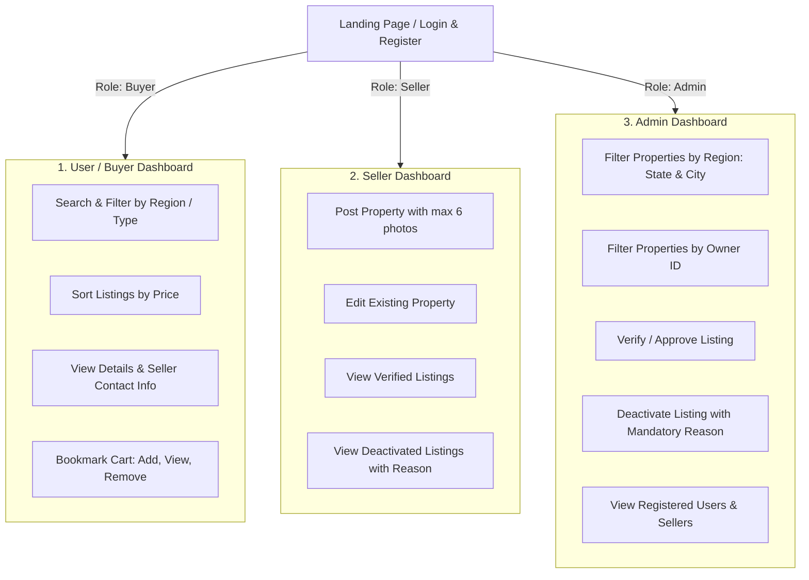

# Easy Housing Solutions (EHS) - Beginner & Viva Guide

> **Project**: Easy Housing Solutions (EHS)  
> **Course**: Capgemini .NET Core & Angular Sprint  
> **Tech Stack**: ASP.NET Core (.NET 8), Entity Framework Core, SQL Server LocalDB, Angular 18, Ocelot Gateway  
> **Frontend Architecture**: 3 Distinct Role-Based Dashboards (User, Seller, Admin)

---

## 1. Project Overview & Architecture

**Easy Housing Solutions (EHS)** is a web-based real-estate marketplace connecting property owners, buyers, and administrators. 

### A. The 3 Dedicated Dashboards (Frontend)

To keep the application beginner-friendly, clean, and modular, the frontend is organized into **three distinct role-based dashboards**:



1. **User / Buyer Dashboard (`user-dashboard`)**:
   * Search verified properties with state, city, property type, and purpose filters.
   * Sort listings by price (Low to High / High to Low).
   * Click **"Contact Owner"** to view the seller's verified phone and email.
   * Manage wishlist bookmark cart (Add, View, Remove, Clear).
   * Direct Purchase/Rent action with purchase history view.
2. **Seller Dashboard (`seller-portal`)**:
   * Post new properties with photo upload strictly enforcing the **maximum 6 photos** rule.
   * Edit existing listings and update prices or amenities.
   * View separate tabs for **Verified** listings vs **Deactivated** listings (with admin feedback).
3. **Admin Dashboard (`admin-panel`)**:
   * Filter properties by **Region** (State & City dropdowns) and by **Owner** (Seller ID).
   * **Verify** pending listings with one click.
   * **Deactivate** non-compliant listings with a **mandatory reason** string.
   * View the complete directory of registered Buyers and Sellers.

---

### B. Microservices Ecosystem (Backend)

The backend structure is built with **ASP.NET Core (.NET 8)** using a Microservices Architecture. Each service has its own database and responsibility. An **Ocelot API Gateway** acts as the single door for the frontend.

| Service | Port | Database | Primary Responsibility |
| :--- | :--- | :--- | :--- |
| **ApiGateway** | `5000` | N/A | Single entry point using Ocelot; aggregates routes and Swagger |
| **IdentityService** | `5001` | `EHS_IdentityDb` | User credentials (`Users` table), registration, and JWT token issuance |
| **PropertyService** | `5002` | `EHS_PropertyDb` | Properties, Images (max 6), States, Cities, verification/deactivation |
| **UserService** | `5003` | `EHS_UserDb` | Buyer and Seller profiles (`Buyer`, `Seller` tables) and Admin user listings |
| **CartService** | `5004` | `EHS_CartDb` | Buyer bookmark Cart (`Cart` table) |
| **AngularUI** | `4200` | N/A | Frontend presentation layer built with Angular 18 |

---

### C. Clean Architecture Inside Each Service

Each microservice follows Clean Architecture with 4 distinct layers:
1. **API Layer (`.API`)**: REST Controllers handling HTTP requests (`PropertiesController`, `AuthController`).
2. **Application Layer (`.Application`)**: Business logic & validation services (`PropertyAppService`, `CartAppService`).
3. **Domain Layer (`.Domain`)**: Core C# entities and repository interfaces (`Property`, `IPropertyRepository`).
4. **Infrastructure Layer (`.Infrastructure`)**: Entity Framework Core repositories that query SQL Server LocalDB (`PropertyRepositories.cs`, `CartRepository.cs`).

#### The "Restaurant Analogy" for Viva:
* **API Gateway** = The **Receptionist** (routes requests to the right counter).
* **API Controllers** = The **Waiters** (take orders and return responses).
* **Application Services** = The **Kitchen Chefs** (enforce business rules, e.g. max 6 images).
* **Domain Entities** = The **Recipe Book** (defines what a Property or User is).
* **Infrastructure Repositories** = The **Pantry** (fetches ingredients from SQL Server).

---

## 2. One-Click Execution Guide

### Step 1: Start Everything (1 Click)
Double-click `start-all.bat` (or run in terminal):
```cmd
.\start-all.bat
```
This opens 6 labeled console windows:
* `5000`: ApiGateway & Swagger
* `5001`: IdentityService
* `5002`: PropertyService
* `5003`: UserService
* `5004`: CartService
* `4200`: Angular Frontend UI

Once loaded, access:
* **Frontend Application**: 👉 **http://localhost:4200**
* **Unified Swagger Documentation**: 👉 **http://localhost:5000/swagger**

### Step 2: Reset Test Data (Whenever Needed)
If you ever want to reset test accounts and database listings to default:
```cmd
.\reset-databases.bat
```

### Step 3: Stop Everything
To cleanly terminate all running backend and frontend background processes:
```cmd
.\stop-all.bat
```

---

## 3. Default Test Credentials

All databases are pre-seeded with test accounts:

| Role | Email / Username | Password | Notes |
| :--- | :--- | :--- | :--- |
| **Administrator** | `admin@easysolution.com` | `AdminPassword123!` | Accesses Admin Dashboard: moderation & user directory |
| **Owner / Seller** | `seller@demo.com` | `SellerPassword123!` | Accesses Seller Dashboard: post & manage properties |
| **Consumer / Buyer** | `buyer@demo.com` | `BuyerPassword123!` | Accesses User Dashboard: search, cart, and contact |

*(Tip: On the Landing Page, you can click "Quick Demo" to instantly fill these!)*

---

## 4. Demonstration Checklist (All 15 Capgemini Requirements)

| # | Requirement | Where to Demo in UI | How it Works |
| :--- | :--- | :--- | :--- |
| **1** | **User Registration & Login** | **Landing Page** | Select "Register Buyer" or "Register Seller". Fill fields and submit. Login automatically redirects to that role's dashboard. |
| **2** | **Add Property** | **Seller Dashboard** $\rightarrow$ Post Property | Enter Name, Type, Option (Sell/Rent), Price, Landmark, Address, State, City. |
| **3** | **Upload Images (max 6)** | **Seller Dashboard** $\rightarrow$ Post Property | Upload photos via file browser or image URL. System strictly validates a maximum of 6 photos per property. |
| **4** | **Edit Property** | **Seller Dashboard** $\rightarrow$ My Listings | Click "Edit" on any listing. It loads details into the form and allows updating price or amenities. |
| **5** | **View Verified Properties** | **Seller Dashboard** $\rightarrow$ My Listings | Click the "Verified Listings" pill to view only listings approved by Admin. |
| **6** | **View Deactivated Properties** | **Seller Dashboard** $\rightarrow$ My Listings | Click "Deactivated Listings". Shows a prominent red box with the mandatory **Deactivation Reason** recorded by Admin. |
| **7** | **View Property by Region** | **Admin Dashboard** $\rightarrow$ Moderation | Filter listings using the **State** and **City** dropdowns. |
| **8** | **View Property by Owner** | **Admin Dashboard** $\rightarrow$ Moderation | Enter a Seller ID in the "Filter by Owner" field to view all listings by that owner. |
| **9** | **Verify / Deactivate with Reason** | **Admin Dashboard** $\rightarrow$ Moderation | Click "Verify" to approve a property. Click "Deactivate" to open the prompt requiring a mandatory reason string. |
| **10** | **Search & Sort by Price** | **User Dashboard** $\rightarrow$ Browse | Search by city or type. Use the "Sort By" dropdown: "Price: Low to High" or "Price: High to Low". Default order is by name. |
| **11** | **View Details & Contact** | **User Dashboard** $\rightarrow$ Property Card | Click "Contact Owner". A modal pops up displaying the owner's Full Name, Email, and Phone Number. |
| **12** | **Add to Cart** | **User Dashboard** $\rightarrow$ Property Card | Click "Save" on any property card. It gets added to the buyer's bookmark cart. |
| **13** | **View Cart** | **User Dashboard** $\rightarrow$ My Wishlist Cart | Click the "My Wishlist Cart" tab to view all bookmarked properties with thumbnails, prices, and locations. |
| **14** | **Delete from Cart** | **User Dashboard** $\rightarrow$ My Wishlist Cart | Click "Remove" next to an item or click "Clear Entire Cart". |
| **15** | **Common Error Page** | **Global UI** | When a network failure or invalid route occurs, the application gracefully displays the friendly Common Error component. |

---

## 5. Top 10 Viva Questions & Answers

### Q1: Why did you divide the frontend into three separate dashboards?
> **Answer**: "To follow the **Single Responsibility Principle** and provide clean **Role-Based Access Control (RBAC)**. A Buyer cares about searching, bookmarking, and owner contact details; a Seller needs to post and track listings with photos; and an Admin reviews listings and moderates them. Separate dashboards make the code clean, modular, and easy to maintain."

### Q2: What architecture did you use for the backend?
> **Answer**: "We used a **Microservices Architecture** with **ASP.NET Core (.NET 8)** and **Clean Architecture** inside each service. We have 4 domain microservices—IdentityService, PropertyService, UserService, and CartService—coordinated through an **Ocelot API Gateway** on port 5000."

### Q3: Where is the Repository Pattern implemented?
> **Answer**: "The Repository Pattern is implemented in the **Infrastructure layer** of each microservice (`PropertyRepositories.cs`, `CartRepository.cs`, etc.). The repository interfaces are defined in Domain/Application (`IPropertyRepository`), and the concrete implementation injects the EF Core `DbContext` to perform database queries."

### Q4: How does the Ocelot API Gateway work?
> **Answer**: "Ocelot acts as a reverse proxy on port 5000. It reads `ocelot.json`, which maps incoming frontend URL routes to the respective downstream microservices (e.g. `/api/properties/*` forwards to port 5002, `/api/cart/*` to port 5004). This allows the Angular frontend to connect to a single base URL."

### Q5: How is user authentication and security handled?
> **Answer**: "We use **JSON Web Tokens (JWT)**. When a user logs in via `IdentityService`, credentials are verified, and a signed JWT containing claims (such as `userType` and `profileId`) is issued. The Angular frontend's `auth.interceptor.ts` automatically attaches this token as a `Bearer` token in the HTTP Authorization header."

### Q6: How do you enforce the maximum 6 images requirement?
> **Answer**: "We enforce it at two levels:
> 1. In the Angular **Seller Dashboard**, the UI checks `uploadedImages.length >= 6` and disables further uploads with a counter (`X / 6 photos`).
> 2. In the backend **PropertyAppService**, business logic validates that the property image count does not exceed 6 before persisting to the database."

### Q7: Why does each microservice have its own database?
> **Answer**: "Each service follows the **Database-per-Service** pattern (`EHS_IdentityDb`, `EHS_PropertyDb`, `EHS_UserDb`, `EHS_CartDb`). This ensures loose coupling: changes to user profile tables in `UserService` do not affect property listings in `PropertyService`."

### Q8: How does an Admin deactivate a property with a reason?
> **Answer**: "The Administrator clicks 'Deactivate' on the Admin Dashboard, which prompts for a mandatory reason. The frontend calls `PUT /api/properties/{id}/reject` with `{ reason: '...' }`. The backend sets `IsActive = false` and stores the `DeactivationReason`. The seller can then view this reason in their Seller Dashboard under Deactivated Listings."

### Q9: Why are backend methods asynchronous (`async`/`await`)?
> **Answer**: "Asynchronous programming using `Task<T>` and `await` ensures non-blocking I/O. While Entity Framework Core is waiting for SQL Server to execute queries or save changes, the thread is returned to the ASP.NET Core thread pool to serve other incoming requests, making the microservices highly scalable."

### Q10: How do you run the backend unit tests?
> **Answer**: "Unit tests are written with **NUnit** and **Moq** in `Shared/EasyHousingSolution.Tests`. We run them using the .NET CLI:
> ```cmd
> dotnet test Shared/EasyHousingSolution.Tests/EasyHousingSolution.Tests.csproj
> ```
> All 7 unit tests pass, verifying verified listing filters, single property retrieval, buyer purchase flows, and preventing sellers from buying their own properties."
