# Traditional Chen Entity-Relationship (ER) Diagram
### Easy Housing Solutions (EHS) — Peter Chen Standard Model Notation

---

## 1.0 Notation Legend

| Symbol / Shape | Meaning in Peter Chen Model | Example in EHS |
| :--- | :--- | :--- |
| **Rectangle** | **Strong Entity** (Independent table / object) | `STATE`, `CITY`, `APP_USER`, `SELLER`, `BUYER`, `PROPERTY` |
| **Double Rectangle** | **Weak Entity** (Existence-dependent on parent entity) | `IMAGES` (depends on `PROPERTY`), `CART` (bookmark junction) |
| **Diamond** | **Relationship** (Associative action between entities) | `CONTAINS`, `STATE_OF`, `CITY_OF`, `LOCATED_IN`, `LOGS_IN`, `LISTS`, `PURCHASES`, `BOOKMARKS`, `REFERENCES` |
| **Double Diamond** | **Identifying Relationship** (Binds weak entity to owner) | `INCLUDES` (Binds `IMAGES` to `PROPERTY`) |
| **Ellipse** | **Attribute** (Property / Column) | `PropertyName`, `PriceRange`, `FirstName`, `EmailId` |
| **Gold Ellipse** | **Primary Key (PK)** (Unique Identifier) | `StateId`, `CityId`, `UserId`, `SellerId`, `BuyerId`, `PropertyId`, `ImageId`, `CartId` |
| **1 / N / M / 0..6** | **Cardinality Ratio** | 1:N (One to Many), 1:1 (One to One), 0..6 (Image limit invariant) |

---

## 2.0 Peter Chen ER Diagram (Mermaid Markdown Code)

```mermaid
flowchart TD
    %% ==========================================
    %% PETER CHEN ER DIAGRAM STYLES
    %% ==========================================
    classDef entity fill:#f0f9ff,stroke:#0284c7,stroke-width:2.5px,color:#0369a1,font-weight:bold;
    classDef weakEntity fill:#f0f9ff,stroke:#0284c7,stroke-width:4px,color:#0369a1,font-weight:bold;
    classDef relationship fill:#fffbeb,stroke:#d97706,stroke-width:2px,color:#b45309,font-weight:bold;
    classDef identifyingRel fill:#fffbeb,stroke:#d97706,stroke-width:3.5px,color:#b45309,font-weight:bold;
    classDef attribute fill:#ffffff,stroke:#64748b,stroke-width:1.5px,color:#1e293b,font-size:11px;
    classDef pkAttribute fill:#fef9c3,stroke:#ca8a04,stroke-width:2px,color:#854d0e,font-weight:bold,font-size:11px;

    %% ==========================================
    %% 1. ENTITIES (Rectangles & Double Rectangles)
    %% ==========================================
    STATE["STATE"]:::entity
    CITY["CITY"]:::entity
    APP_USER["APP_USER"]:::entity
    SELLER["SELLER"]:::entity
    BUYER["BUYER"]:::entity
    PROPERTY["PROPERTY"]:::entity
    IMAGES[["IMAGES\n(Weak Entity)"]]:::weakEntity
    CART[["CART\n(Weak Entity)"]]:::weakEntity

    %% ==========================================
    %% 2. RELATIONSHIPS (Diamonds)
    %% ==========================================
    REL_CONTAINS{"CONTAINS"}:::relationship
    REL_STATE_OF{"STATE_OF"}:::relationship
    REL_CITY_OF{"CITY_OF"}:::relationship
    REL_LOCATED_IN{"LOCATED_IN"}:::relationship
    REL_LOGS_IN_S{"LOGS_IN"}:::relationship
    REL_LOGS_IN_B{"LOGS_IN"}:::relationship
    REL_MODERATES{"MODERATES"}:::relationship
    REL_LISTS{"LISTS"}:::relationship
    REL_PURCHASES{"PURCHASES"}:::relationship
    REL_BOOKMARKS{"BOOKMARKS"}:::relationship
    REL_INCLUDES{"INCLUDES"}:::identifyingRel
    REL_REFERENCES{"REFERENCES"}:::relationship

    %% ==========================================
    %% 3. PRIMARY KEY ATTRIBUTES (Gold Ellipses)
    %% ==========================================
    PK_StateId(["StateId (PK)"]):::pkAttribute
    PK_CityId(["CityId (PK)"]):::pkAttribute
    PK_UserId(["UserId (PK)"]):::pkAttribute
    PK_SellerId(["SellerId (PK)"]):::pkAttribute
    PK_BuyerId(["BuyerId (PK)"]):::pkAttribute
    PK_PropertyId(["PropertyId (PK)"]):::pkAttribute
    PK_ImageId(["ImageId (PK)"]):::pkAttribute
    PK_CartId(["CartId (PK)"]):::pkAttribute

    %% ==========================================
    %% 4. REGULAR ATTRIBUTES (White Ellipses)
    %% ==========================================
    ATTR_StateName(["StateName"]):::attribute
    ATTR_CityName(["CityName"]):::attribute
    ATTR_PasswordHash(["PasswordHash"]):::attribute
    ATTR_Role(["Role"]):::attribute
    ATTR_UserActive(["IsActive"]):::attribute

    ATTR_SellerUser(["UserName"]):::attribute
    ATTR_SellerFirst(["FirstName"]):::attribute
    ATTR_SellerLast(["LastName"]):::attribute
    ATTR_SellerDob(["DateOfBirth"]):::attribute
    ATTR_SellerPhone(["PhoneNo"]):::attribute
    ATTR_SellerAddress(["Address"]):::attribute
    ATTR_SellerEmail(["EmailId"]):::attribute

    ATTR_BuyerFirst(["FirstName"]):::attribute
    ATTR_BuyerLast(["LastName"]):::attribute
    ATTR_BuyerEmail(["EmailId"]):::attribute
    ATTR_BuyerPhone(["PhoneNo"]):::attribute
    ATTR_BuyerDob(["DateOfBirth"]):::attribute

    ATTR_PropName(["PropertyName"]):::attribute
    ATTR_PropType(["PropertyType"]):::attribute
    ATTR_PropOpt(["PropertyOption"]):::attribute
    ATTR_PropPrice(["PriceRange"]):::attribute
    ATTR_PropDeposit(["InitialDeposit"]):::attribute
    ATTR_PropAddr(["Address"]):::attribute
    ATTR_PropLandmark(["Landmark"]):::attribute
    ATTR_PropDesc(["Description"]):::attribute
    ATTR_PropActive(["IsActive"]):::attribute
    ATTR_PropDeact(["DeactivationReason"]):::attribute

    ATTR_ImageVal(["Image"]):::attribute
    ATTR_CartBuyer(["BuyerId"]):::attribute
    ATTR_CartProp(["PropertyId"]):::attribute

    %% ==========================================
    %% 5. ENTITY TO ATTRIBUTE BINDINGS
    %% ==========================================
    STATE --- PK_StateId
    STATE --- ATTR_StateName

    CITY --- PK_CityId
    CITY --- ATTR_CityName

    APP_USER --- PK_UserId
    APP_USER --- ATTR_PasswordHash
    APP_USER --- ATTR_Role
    APP_USER --- ATTR_UserActive

    SELLER --- PK_SellerId
    SELLER --- ATTR_SellerUser
    SELLER --- ATTR_SellerFirst
    SELLER --- ATTR_SellerLast
    SELLER --- ATTR_SellerDob
    SELLER --- ATTR_SellerPhone
    SELLER --- ATTR_SellerAddress
    SELLER --- ATTR_SellerEmail

    BUYER --- PK_BuyerId
    BUYER --- ATTR_BuyerFirst
    BUYER --- ATTR_BuyerLast
    BUYER --- ATTR_BuyerEmail
    BUYER --- ATTR_BuyerPhone
    BUYER --- ATTR_BuyerDob

    PROPERTY --- PK_PropertyId
    PROPERTY --- ATTR_PropName
    PROPERTY --- ATTR_PropType
    PROPERTY --- ATTR_PropOpt
    PROPERTY --- ATTR_PropPrice
    PROPERTY --- ATTR_PropDeposit
    PROPERTY --- ATTR_PropAddr
    PROPERTY --- ATTR_PropLandmark
    PROPERTY --- ATTR_PropDesc
    PROPERTY --- ATTR_PropActive
    PROPERTY --- ATTR_PropDeact

    IMAGES --- PK_ImageId
    IMAGES --- ATTR_ImageVal

    CART --- PK_CartId
    CART --- ATTR_CartBuyer
    CART --- ATTR_CartProp

    %% ==========================================
    %% 6. RELATIONSHIPS & CARDINALITIES (1, N, M)
    %% ==========================================
    STATE ---|"1"| REL_CONTAINS
    REL_CONTAINS ---|"N"| CITY

    STATE ---|"1"| REL_STATE_OF
    REL_STATE_OF ---|"N"| SELLER

    CITY ---|"1"| REL_CITY_OF
    REL_CITY_OF ---|"N"| SELLER

    CITY ---|"1"| REL_LOCATED_IN
    REL_LOCATED_IN ---|"N"| PROPERTY

    APP_USER ---|"1"| REL_LOGS_IN_S
    REL_LOGS_IN_S ---|"1"| SELLER

    APP_USER ---|"1"| REL_LOGS_IN_B
    REL_LOGS_IN_B ---|"1"| BUYER

    APP_USER ---|"1"| REL_MODERATES
    REL_MODERATES ---|"N"| PROPERTY

    SELLER ---|"1"| REL_LISTS
    REL_LISTS ---|"N"| PROPERTY

    BUYER ---|"1"| REL_PURCHASES
    REL_PURCHASES ---|"N"| PROPERTY

    BUYER ---|"1"| REL_BOOKMARKS
    REL_BOOKMARKS ---|"N"| CART

    PROPERTY ---|"1"| REL_INCLUDES
    REL_INCLUDES ---|"0..6"| IMAGES

    PROPERTY ---|"1"| REL_REFERENCES
    REL_REFERENCES ---|"N"| CART
```

---

## 3.0 Entity & Relationship Mapping Summary

| Source Entity | Relationship (Diamond) | Target Entity | Cardinality | Business Meaning |
| :--- | :--- | :--- | :--- | :--- |
| **STATE** | `CONTAINS` | **CITY** | `1 : N` | Each State contains multiple registered Cities. |
| **STATE** | `STATE_OF` | **SELLER** | `1 : N` | A State is referenced by Seller addresses. |
| **CITY** | `CITY_OF` | **SELLER** | `1 : N` | A City is referenced by Seller addresses. |
| **CITY** | `LOCATED_IN` | **PROPERTY** | `1 : N` | A City locates multiple posted Properties. |
| **APP_USER** | `LOGS_IN` | **SELLER** | `1 : 1` | Credentials in `IdentityDb` synchronize with Seller profile. |
| **APP_USER** | `LOGS_IN` | **BUYER** | `1 : 1` | Credentials in `IdentityDb` synchronize with Buyer profile. |
| **APP_USER (Admin)** | `MODERATES` | **PROPERTY** | `1 : N` | Admins approve listings or deactivate them with a mandatory reason. |
| **SELLER** | `LISTS` | **PROPERTY** | `1 : N` | Sellers post property listings for sell or rent. |
| **BUYER** | `PURCHASES` | **PROPERTY** | `1 : N` | Buyers purchase listings, marking them inactive as `"Sold to Buyer #{id}"`. |
| **BUYER** | `BOOKMARKS` | **CART** | `1 : N` | Buyers bookmark properties into their cart. |
| **PROPERTY** | `INCLUDES` | **IMAGES** | `1 : 0..6` | Each property can have up to 6 uploaded photos (Weak entity). |
| **PROPERTY** | `REFERENCES` | **CART** | `1 : N` | Properties are referenced by cart bookmark items. |

---

*Related Documents*:
- Full Low-Level Design: [BACKEND_LLD.md](file:///c:/Users/sgupt251/OneDrive - Capgemini/Desktop/P1/BACKEND_LLD.md)
- High-Level Design: [BACKEND_HLD.md](file:///c:/Users/sgupt251/OneDrive - Capgemini/Desktop/P1/BACKEND_HLD.md)
- Interactive HTML View: [chen_er_diagram.html](file:///c:/Users/sgupt251/OneDrive - Capgemini/Desktop/P1/chen_er_diagram.html)
